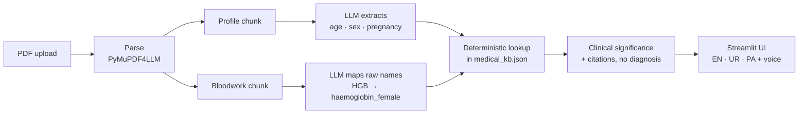

<div align="center">

# 🩺 Lab Report Analyzer

**Upload a medical lab report PDF and get every result checked against Pakistani reference ranges, explained in English, Urdu or Punjabi, with voice input and read-aloud output.**


</div>

---

## Why

Lab reports are full of abbreviations, and their "normal" ranges usually come from Western populations. This tool reads a report, works out who the patient is (age, sex, pregnancy and trimester), and compares each value with the **right** range for that person. Pakistani reference intervals come first, with global ranges as a fallback.

It is deliberately **not a diagnostic tool**. It reports high or low values and what the knowledge base says about them, with citations and a disclaimer.

## How it works



The LLM is used **only** where language understanding is needed (reading the profile and normalising test names). The reference-range comparison itself is **deterministic Python** against a curated JSON knowledge base, so the numbers can't be hallucinated.

## Features

- 📄 **Smart PDF parsing:** splits a report into a profile chunk and a bloodwork chunk
- 🧠 **LLM profile extraction** (Groq, Llama 3.3 70B), with a form for any missing fields
- 🔤 **Semantic test normalisation:** maps raw names like `HGB` or `Hb` to knowledge-base IDs, picking sex-specific variants
- 🤰 **Pregnancy-aware ranges:** trimester-specific intervals where they exist, with safe fallbacks
- 🇵🇰 **Local reference intervals:** 125 tests with Pakistani reference ranges (Pakistan RI study, 2024) plus global fallback
- 🌐 **Multilingual UI:** English, Urdu (اردو) and Punjabi (پنجابی)
- 🎙️ **Voice:** speak your profile details (speech-to-text) and listen to the report (gTTS)

## Getting started

```bash
git clone https://github.com/fast-na-ana/lab-report-analyzer.git
cd lab-report-analyzer
pip install -r requirements.txt
cp .env.example .env        # then paste your Groq API key into .env
streamlit run main.py
```

Get a free API key at [console.groq.com](https://console.groq.com/). Voice input needs a working microphone and PyAudio.

### Try it with the sample reports

[`samples/`](samples/) has five synthetic lab reports (1 to 11 pages, one with no patient name) for testing. They were generated for this project and contain no real patient data.

## Project structure

```
main.py           Streamlit UI, language switching, session state
parser.py         PDF → profile chunk + bloodwork chunk
normalizer.py     LLM mapping of raw test names → KB test IDs (sex- and pregnancy-aware)
lookup.py         deterministic reference-range retrieval with stratification
decision.py       high/low status, clinical significance, disclaimers
voice_utils.py    speech-to-text and text-to-speech (EN / UR / PA)
medical_kb.json   curated knowledge base (125 tests)
samples/          synthetic lab reports for testing
```

## Tech stack

Python · Streamlit · Groq API (Llama 3.3 70B) · PyMuPDF4LLM · gTTS · SpeechRecognition · python-dotenv

## Limitations

- Works best on text-based PDFs; scanned images would need OCR first
- Covers the 125 tests in the knowledge base
- Not a medical device: results must be reviewed by a qualified clinician

## Team

Built with Hania Zahra. Forked from the original team repository [curlyline-h/lab-report-analyzer](https://github.com/curlyline-h/lab-report-analyzer).

> ⚠️ **Disclaimer:** for educational purposes only. This tool does not provide medical diagnosis or treatment advice.
